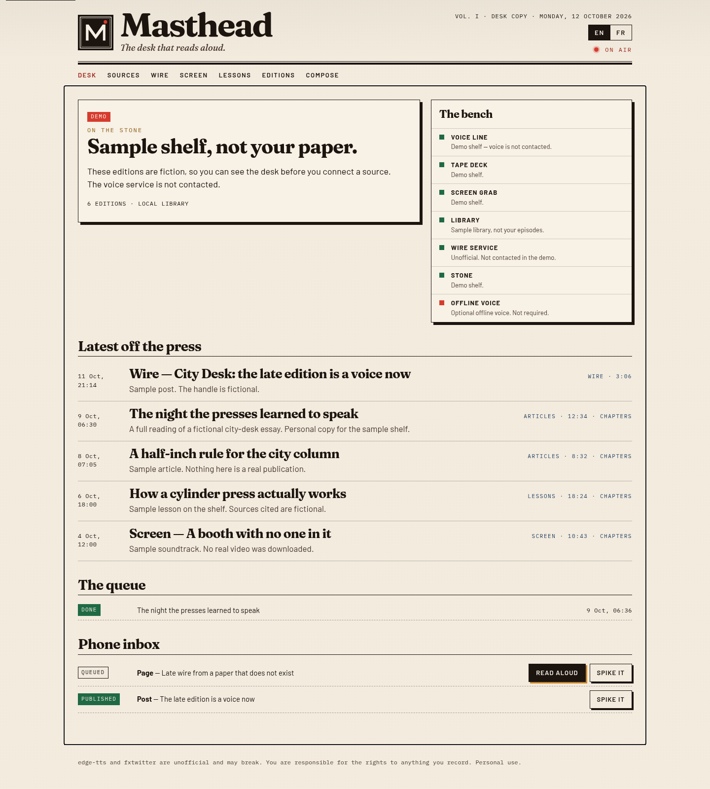
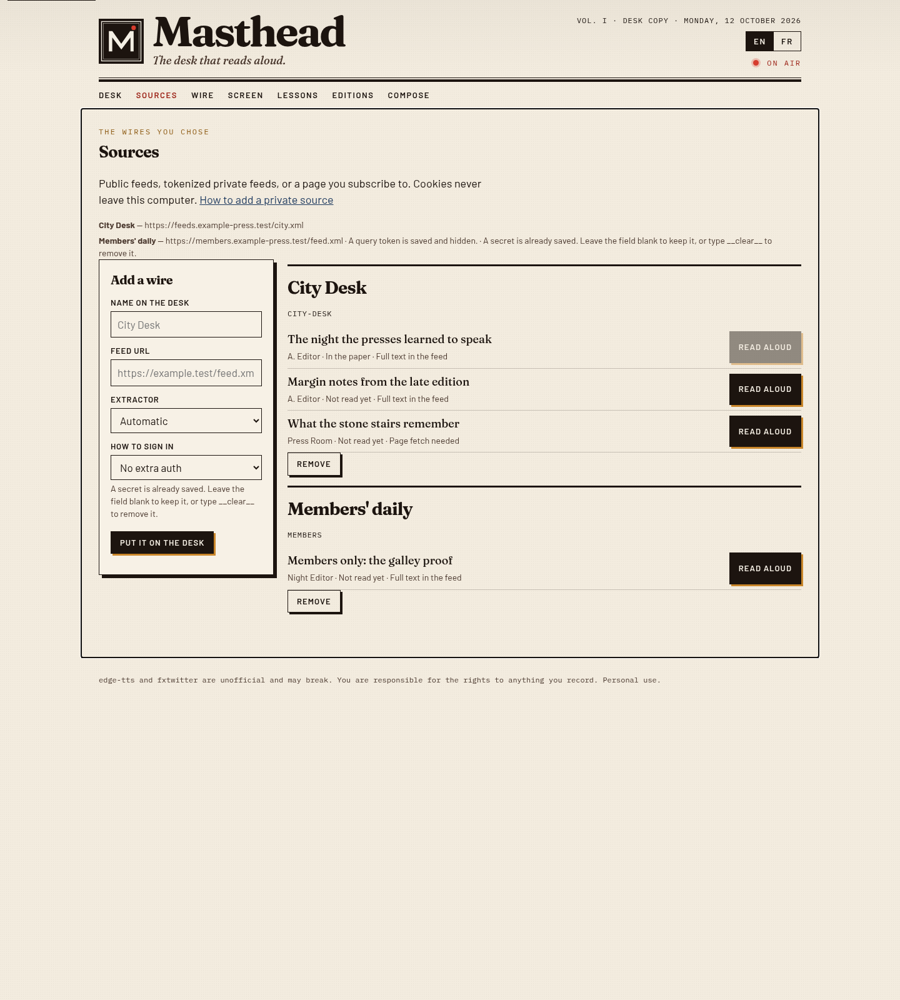
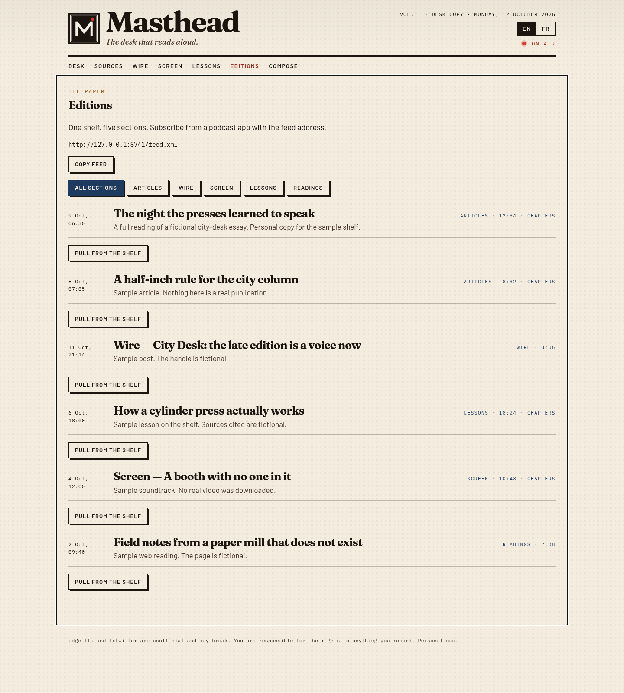
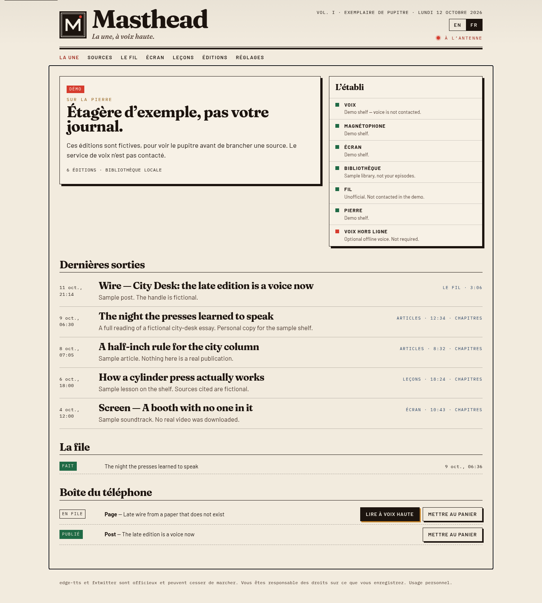

# Masthead


**Beta.** This is `0.1.0-beta`. Expect breaking changes before 1.0.

The desk that reads aloud.

Masthead turns sources you already have the right to read into a personal podcast: RSS articles, X posts and threads, video soundtracks, web pages, and short lessons. It runs on your computer. Publishing the feeds is optional, and it publishes them to a Cloudflare account you own.



## Before you record anything

- **edge-tts** talks to a Microsoft speech endpoint through an unofficial client. Microsoft can block it. When that happens, switch the voice engine to Piper.
- **fxtwitter** (`api.fxtwitter.com`) is an unofficial way to read public posts. It can change or disappear.
- **You are responsible for the rights** to the articles, posts, pages, and videos you convert. Masthead is for personal use. It does not ship logins or scrapers for commercial paywalls. Do not share the feed if the underlying material is not yours to share.

## What you get

- A local desk at `http://127.0.0.1:8741` with the interface in English or French.
- Any edge-tts voice id, or an offline Piper model. The default voice is `en-US-AriaNeural`. A French multilingual voice is in the suggested list.
- Five feeds: articles, the wire, screen, lessons, and readings. Chapters are written as ID3 `CHAP` frames and as Podcasting 2.0 JSON.
- An Android share-target page once you deploy your own Worker.
- A place to add a private feed yourself. See [docs/private-feeds.md](docs/private-feeds.md).

## Run the sample shelf

You need Node.js 18 or newer and Python 3.10 or newer. The sample shelf does not call the voice service or the wire.

```bash
npm run demo
```

Open [http://127.0.0.1:8741](http://127.0.0.1:8741). The editions on that shelf are fiction.

`npm start` is the same desk without the sample data. With an empty config it asks you to add a source. Episodes stay in `data/` on this computer until you configure R2.

## Record for real

ffmpeg is required. Debian/Ubuntu: `sudo apt install ffmpeg`. macOS: `brew install ffmpeg`.

```bash
./installer.sh
npm start
```

`./installer.sh` creates `.venv`, then installs edge-tts and yt-dlp. `./installer.sh --piper en` or `--piper fr` also downloads one offline Piper voice. Point Compose at that model and install the Piper binary for your system if you want to avoid the online voice.

Paste a feed you are allowed to fetch under Sources, or send a page URL from Screen, the wire, or Lessons. Jobs run one at a time. Logs drop query strings.

## Publish feeds from your own Cloudflare account

`./setup.sh` is the first-run publisher. It logs in through Wrangler, creates an R2 bucket, deploys the Worker in `cloudflare/`, uploads the covers, generates an inbox token, and stores that token as the `INBOX_TOKEN` secret. The token is written to `studio-config.json` (mode 600) and is not printed. Open Compose on this computer to see it.

```bash
./setup.sh --dry-run
./setup.sh --yes --worker-name masthead --bucket masthead-library --lang en
```

Wrangler’s login can deploy and upload. The local engine writes audio to R2 with a Cloudflare API token that has R2 access. Paste that token in Compose. Until the account id, bucket, and token are all set, episodes stay on disk.

`cloudflare/wrangler.jsonc` is generated for you and gitignored. The committed example has no account id.

The phone share page is `https://<your-worker>.workers.dev/share`. The first visit with `?k=` stores an `mh_k` cookie and redirects so the token is not left in the address bar.

## Private or paywalled sources

Read [docs/private-feeds.md](docs/private-feeds.md). Short version: paste a tokenized feed URL, use HTTP basic auth, or store your own session cookie per source. Cookies and tokens stay in `studio-config.json`. To handle a site you subscribe to, add a Python extractor in `extractors/` (gitignored). `engine/extractors/example_member_press.py` is a fictional adapter you can copy.

## Language and voice

The EN / FR switch in the masthead sets the desk language, the spoken dates, and the lesson prompts. Compose accepts any edge-tts voice id, for example `fr-FR-VivienneMultilingualNeural` or `en-GB-SoniaNeural`.

## Design

Masthead is set like a small newspaper: newsprint `#f3ecdf`, ink `#1c140f`, a vermilion on-air lamp `#d63c2e`, brass rules, and a navy link color. Type is Fraunces, Barlow, and IBM Plex Mono, shipped under the SIL Open Font License (`public/fonts/OFL-*.txt`). Covers are the five plates in `public/covers/`.







## Layout

| Path | Role |
| --- | --- |
| `server.js` | Local desk |
| `engine/studio.py` | Fetch, extract, speak, publish |
| `engine/extractors/` | Built-in extractors and the fictional example |
| `cloudflare/` | Worker that serves RSS, audio, covers, and the inbox |
| `docs/private-feeds.md` | How to add a source you subscribe to |
| `setup.sh` | Deploy your Worker and bucket |
| `installer.sh` | Local Python tools |

## Tests

```bash
npm test
```

## License

[MIT](LICENSE). The bundled fonts remain under the SIL Open Font License.
